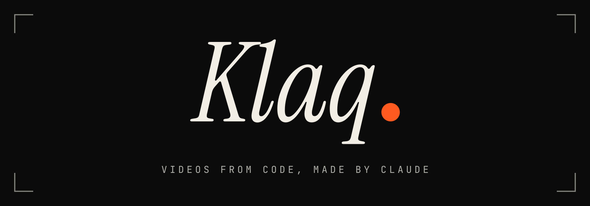
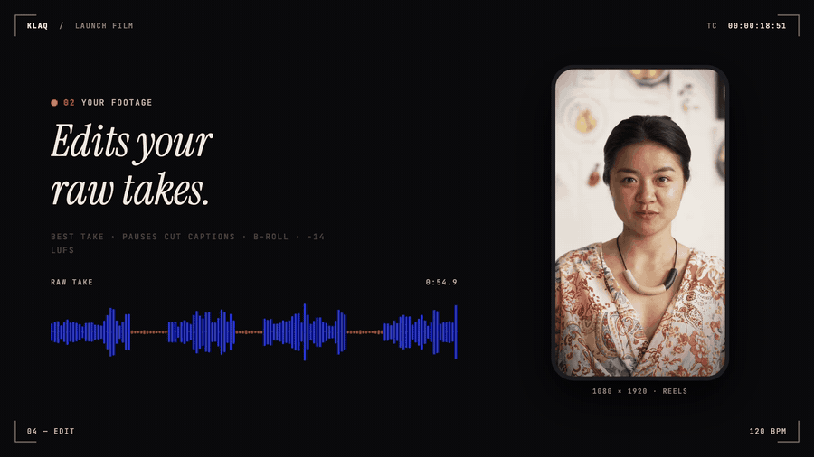

<p align="center">
  
</p>

<p align="center">
  <b>Claude makes your videos, in code.</b><br>
  Motion graphics, launch films, Reels and explainers with synthesized scores, plus edits of your raw talking-head recordings.<br>
  A Claude Code plugin built on <a href="https://www.remotion.dev">Remotion</a>.
</p>

<p align="center">
  <a href="LICENSE"></a>
  
  
</p>

---

## The launch film

https://github.com/user-attachments/assets/7326afa7-95b0-4974-a2bd-67ad6d65ee48

<p align="center">
  <sub>48 s · 1080p60 · sound on · made with Klaq from one prompt, source in <a href="src/compositions/launch"><code>src/compositions/launch</code></a> · <a href="assets/klaq-launch.mp4">download the MP4</a></sub>
</p>

Everything in it came out of Klaq: the picture is React, the score is synthesized from the same timeline, every act was checked as stills before the render, and the mix is measured at −14 LUFS.

<p align="center">
  
</p>

## What Klaq does

| | |
|---|---|
| **Motion design in code** | Springs, kinetic type, fluid, particles, 3D-feeling camera moves, transitions, logo builds. One timeline file drives every frame. |
| **Films from a brief** | Launch films, promos, brand films, explainers and showreels: concept, storyboard, build, review. |
| **Edits your recordings** | Picks the best take of each sentence, cuts pauses and filler words between words, frames on your face, adds word-by-word captions, B-roll, document cards and stamps, then masters the voice to −14 LUFS. |
| **Vertical first** | Native 9:16, 4:5, 1:1 and 16:9 layouts with platform safe zones, hooks and calls to action. |
| **Scores that land on the frame** | Music and sound design synthesized from the film's own timeline, so every hit lands on its frame. Loudness and true peak are measured, not guessed. |
| **Checks its own work** | Stills at every cut, contact sheets, a QA checklist and ffprobe checks on the final MP4 before anything is called done. |
| **Voice-over** | Optional ElevenLabs TTS with timings for captions (bring your own key). |

## How it works

```
you ──▶ /klaq "make a 30 s launch video for my app"
          │
          ├─ brief & storyboard        Claude proposes a concept, you approve
          ├─ timeline.ts               every event on one clock (fps, BPM, named frames)
          ├─ picture (React)  ◀──┐
          ├─ score (synth)    ◀──┴──── both import the same timeline
          ├─ stills + QA               frames looked at, fixed in batches
          └─ render                    MP4, bt709, −14 LUFS, verified with ffprobe
```

For a recording: `/klaq edit my recording` → transcript with word timings → best takes and pauses cut → your face framed in every take → layouts, captions and graphics → a half-resolution preview for your approval → the final master.

## Install

**Claude Code** (CLI, or the Code tab in Claude Desktop):

```bash
claude plugin install klaq --marketplace LeoTexx/klaq
```

or, inside a session: `/plugin marketplace add LeoTexx/klaq`, then `/plugin install klaq@klaq`.

Then ask for a video (`/klaq …`). On first use Claude runs `klaq-setup`, which clones the workspace to `~/klaq` (set `KLAQ_HOME` to change it), installs the packages, checks your tools and pulls the Remotion docs for reference.

**Without the plugin system:**

```bash
git clone https://github.com/LeoTexx/klaq ~/klaq && cd ~/klaq && ./install.sh
```

**Requirements:** Node.js 20+, pnpm, ffmpeg. To edit recordings, also [openai-whisper](https://github.com/openai/whisper) (`pipx install openai-whisper`). Head tracking for framing uses Apple Vision on macOS (`xcode-select --install`); on other systems framing uses a fixed face position. `klaq-setup --check` lists what you have.

> Klaq runs on your machine. Claude chat on claude.ai can't use it, because uploaded skills run in a cloud sandbox without ffmpeg or a renderer. Use Claude Code or the Code tab in Claude Desktop.

## Try it

```text
/klaq make a 20 s vertical teaser for my newsletter, bold type, warm colours
/klaq edit ~/Movies/take-01.mp4 into a Reel with captions, in the style of <reference URL>
/klaq explain how our sync engine works, 60 s, 16:9
/klaq render the showreel
```

Open the studio at any time to scrub what Claude built:

```bash
cd ~/klaq && pnpm studio
```

## Your workspace

Klaq tracks only the engine. Everything you make stays out of git, so `klaq-setup --update` never touches your work.

```
~/klaq
├── src/                      engine (tracked): motion lib, edit pipeline, TalkingHead, synth, scripts
│   └── compositions/         examples: demo, showreel, launch
├── projects/<name>/          your films and edits (gitignored, appear in Studio automatically)
├── public/projects/<name>/   your footage, cuts, B-roll, scores (gitignored)
├── out/<name>/               renders and stills (gitignored)
└── work/<name>/              scratch: transcripts, takes, references (gitignored)
```

| Command | What it does |
|---|---|
| `pnpm new <name>` | Scaffold `projects/<name>/` (`--landscape`, `--square`, `--fps 60`) |
| `pnpm studio` | Remotion Studio with the examples and all your projects |
| `pnpm stills --id <Id> --frames 0,60,120 --sheet 3` | Stills and a contact sheet for review |
| `pnpm render -- --id <Id>` | Render to `out/` |
| `pnpm edit cut <slug> --raw <file>` | Transcribe, choose takes, cut pauses (`ref`, `assemble`, `preview`, `final` follow) |
| `pnpm tts --project <name>` | ElevenLabs voice-over from `projects/<name>/vo.json` |
| `pnpm remocn <name>` | Add a component from the MIT [remocn](https://remocn.dev) registry |

## Examples

| | |
|---|---|
| `Showreel` | 15 s, 60 fps: one orange dot becomes every technique on the reel |
| `Launch` | The 48 s launch film above (run `pnpm tsx src/compositions/launch/prepare.ts` once) |
| `Demo` | The smallest composition, a starting point |

## Good to know

- **Claude can't hear.** Klaq measures loudness and inspects the spectrum, but you approve the sound by ear.
- **Remotion licence.** Remotion is free for individuals and companies of up to 3 people; larger companies need a [company licence](https://remotion.pro/license). Klaq's MIT licence covers only Klaq. See [NOTICE.md](NOTICE.md).
- **Stock footage and music** you add are yours to license. The skill logs each source in your project's `work/<name>/sources.md`.

## Licence

[MIT](LICENSE) © 2026 Leonardo Teixeira dos Santos. Third-party notices in [NOTICE.md](NOTICE.md).
